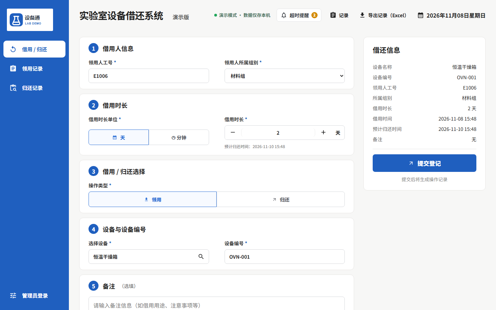

# 设备通 · 实验室设备借还系统（演示版）

面向实验室、仓库、学校、工厂的设备借用与归还登记系统，电脑和手机都能用。
这是**演示版**：不连接任何云端账号，数据只保存在当前浏览器，示例数据均为虚构。



## 功能

- **借用 / 归还登记**：工号、组别、设备、借用时长（按天或分钟），自动算出预计归还时间
- **防止冲突**：已借出的设备不能重复借；归还时必须由原借用人工号归还
- **超时提醒**：距离归还不足 10 分钟标黄，已超时标红
- **记录查询**：领用记录、归还记录分开查看，可按工号、设备名、编号搜索
- **导出 Excel**：带颜色区分状态（借用中 / 已归还 / 逾期）
- **管理员后台**：维护设备清单和组别，删除借还数据，一键恢复示例数据
  - 演示账号：工号 `admin`，密码 `demo123`
- **手机适配**：手机上底部导航

## 可定制（正式版）

- 云端数据库实时同步（多人多设备共用），管理员正式登录
- 设备二维码：贴在设备上，扫码直接进入该设备的借还页面
- 按单位需求增加字段：用途、审批、校准到期、维修记录等
- 部署到自己的域名，或做成微信小程序

## 本地运行

```bash
npm install
npm run dev
```

构建：`npm run build`，输出目录 `dist`，可部署到 Cloudflare Pages、Vercel 等静态托管。

技术栈：React 19 + Vite，Excel 导出用 xlsx-js-style。
